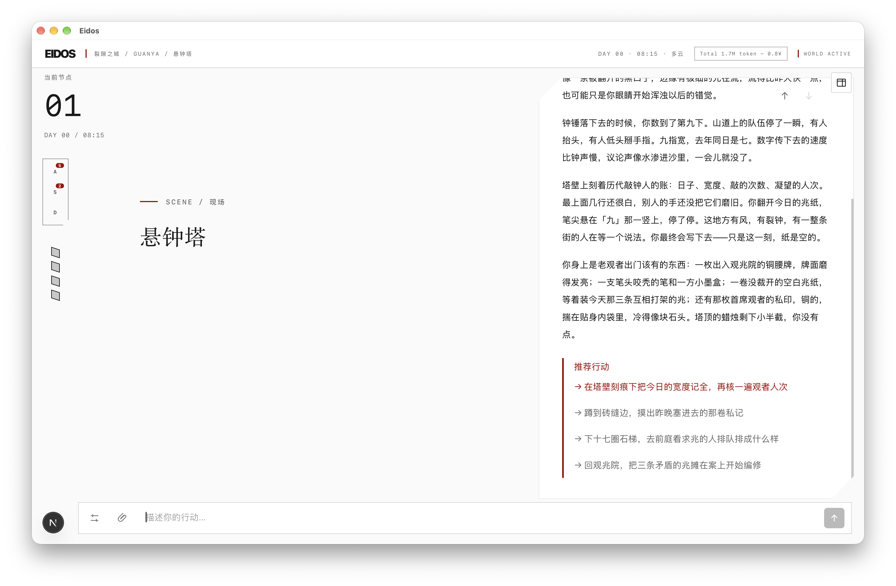
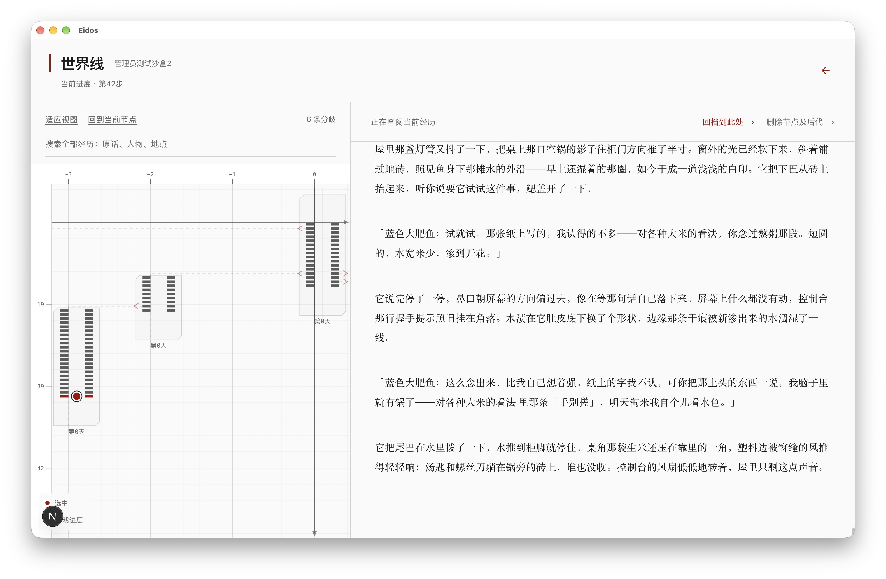
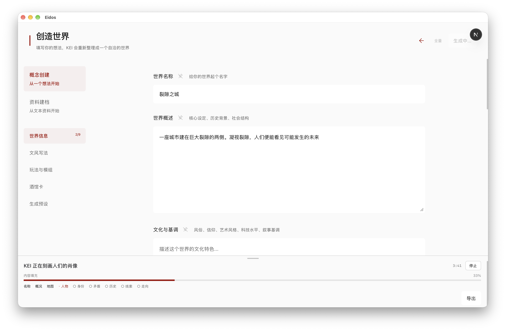

# Eidos

[简体中文](README.md)

Eidos is a text-based AI role-playing game. Write what you say or do, then see how the world responds. Follow a lead, negotiate with a character, or return to an earlier point and try a different choice.

**[Download and play](#download-and-play)** · [How to play](#how-to-play) · [For developers](#for-developers)

*A Rift City gameplay example. Pick a suggested action or write your own.*

## Download and play

Download the portable ZIP below, extract the full archive, then double-click the launcher. Eidos opens in your default browser. For other versions, see the [Releases page](https://github.com/A-Reactor/Eidos/releases).

| Computer | Download | Double-click |
| --- | --- | --- |
| Apple silicon Mac with macOS 13.5 or later | [Eidos-macOS-arm64.zip](https://github.com/A-Reactor/Eidos/releases/latest/download/Eidos-macOS-arm64.zip) | **Eidos.app** |
| 64-bit Intel or AMD Windows PC | `Eidos-Windows-x64.zip`, when listed | **Start Eidos.cmd** |

The portable build includes its runtime. Keep the launcher running while you play, and use the same browser to return to your saves. On Windows, keep the launch window open. macOS may ask you to confirm the preview app the first time you open it. [Apple's opening instructions](https://support.apple.com/102445)

### Your first session

1. To switch the menus to English, open **设置 (Settings) → 显示 (Display) → 界面语言 (Interface language)**, choose **English**, and save. **Narrative language** controls future AI narration separately. The included Rift City setting and saved story are in Chinese.
2. Open **Settings → AI Access**, choose a provider, paste its API key if required, and save. You can also connect a local model service you already run. Cloud providers may charge for usage. [AI setup guide](eidos/docs/ai-configuration.en.md)
3. Return to the title screen and choose **Enter the archive**. Select **Rift City (裂隙之城)** to continue the included playthrough or start a new game and choose an identity.
4. Write your first action, such as “I look around for someone who can give me directions.” Read the response and decide what to do next.

## How to play

### Explore Rift City

A city spans a vast rift. Those who look into it catch glimpses of possible futures. The included playthrough starts at Guanyuan Archive Hall (观渊档案厅). From there, choose where to go and whom to trust.

### Revisit your story

Open the timeline to read earlier actions. You can return to a previous point and explore a different branch.

### Create a world

Start with a premise or existing material, choose gameplay such as investigation or limited rewinds, and enter the world you create. The world library also accepts world packages and character cards.

### Export and share

The world library can export a setting on its own or include playthroughs and saves. Export summaries, action labels, and automatic filename suffixes use English. World names, player input, and story text keep their original language. Eidos can still import older packages.

## For developers

Your game can supply its own scenes, components, map, state, and rules, then pass real outcomes back to Eidos for narration. The application is version 0.1.0 and the standalone SDK is version 0.5.2. [SDK installation, offline demo, and integration guide](eidos/docs/developer-engine.en.md) · [Mod quickstart](eidos/docs/modding.en.md)

The portable edition opens in a browser. The native desktop edition remains in development. [Running the application from source](eidos/docs/developer-engine.en.md#run-the-application-from-source)

## Feedback and license

The maintainer usually reviews issues, pull requests, and security reports once a week. [Contributing](CONTRIBUTING.en.md) · [Security and data](SECURITY.en.md) · [MIT license](LICENSE)
