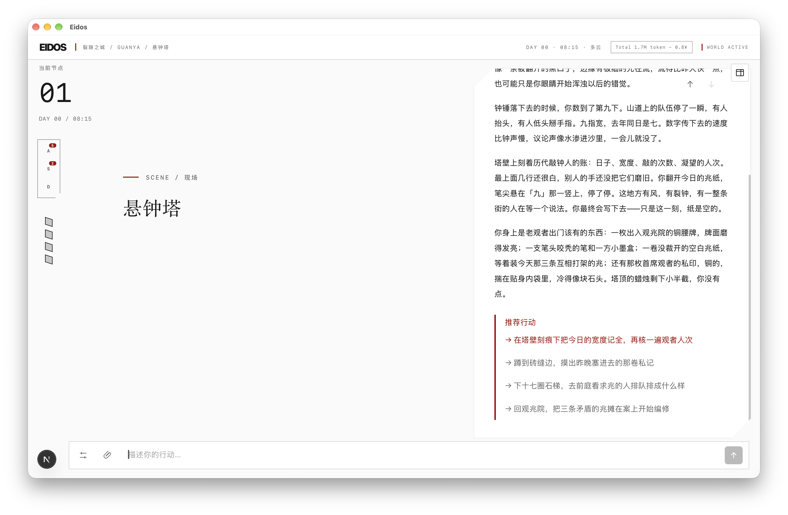
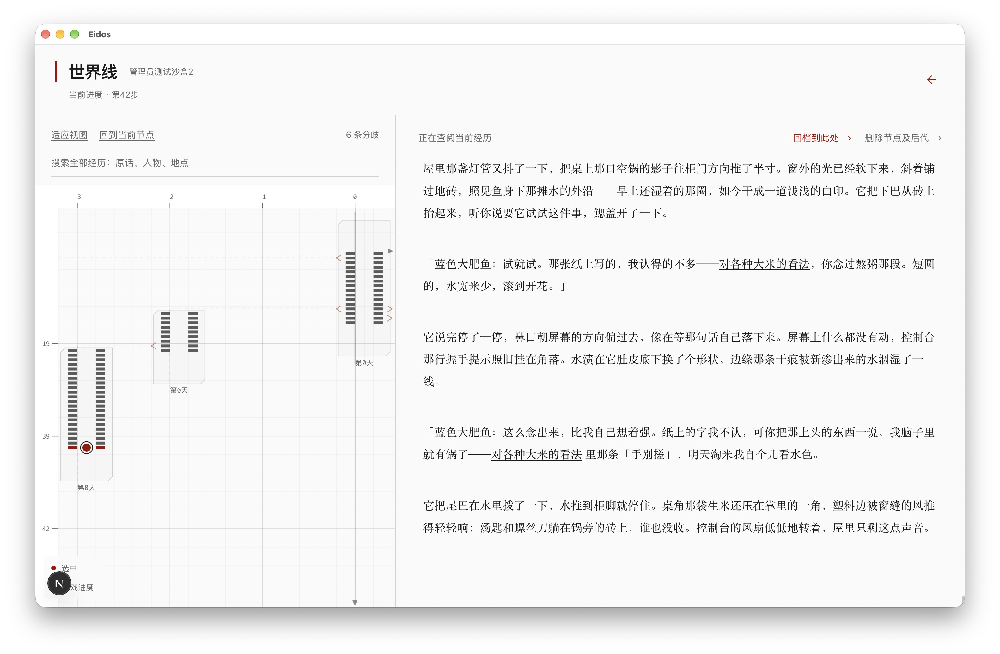
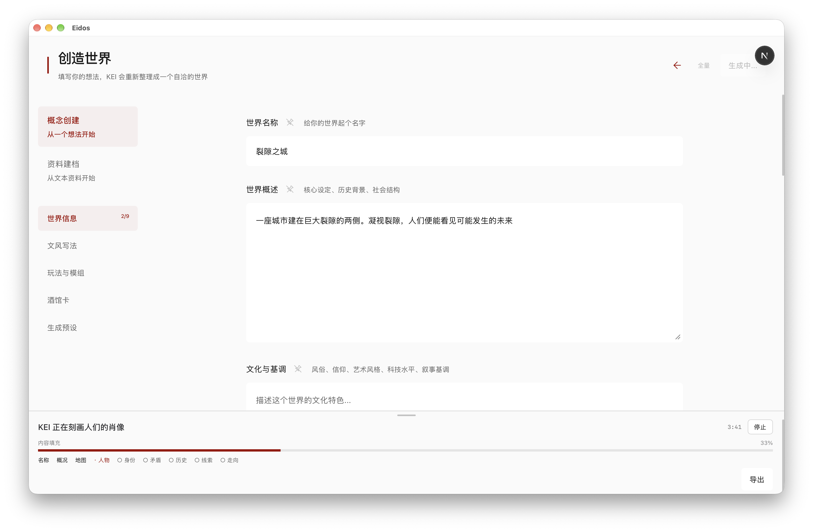

# Eidos

[English](README.en.md)

Eidos 是一个用文字玩的 AI 角色扮演游戏。写下你想说的话或想做的事，故事会随你的行动继续。你可以追查线索、和角色谈判，也可以回到故事的某一步，试试另一种选择。

**[下载开玩](#下载开玩)** · [看看怎么玩](#怎么玩) · [开发者入口](#开发者入口)



*《裂隙之城》的游玩示例。你可以选一条推荐行动，也可以在底部写下自己的做法。*

## 下载开玩

下载下方的便携 ZIP，完整解压后双击启动。游戏会在默认浏览器中打开。其他版本请见[发布页](https://github.com/A-Reactor/Eidos/releases)。

| 电脑 | 下载文件 | 解压后双击 |
| --- | --- | --- |
| Apple 芯片 Mac（macOS 13.5 或更新） | [Eidos-macOS-arm64.zip](https://github.com/A-Reactor/Eidos/releases/latest/download/Eidos-macOS-arm64.zip) | **Eidos.app** |
| 64 位 Windows PC（Intel 或 AMD） | `Eidos-Windows-x64.zip`（发布页列出时） | **Start Eidos.cmd** |

便携包自带运行环境。游玩时保留 Eidos 启动程序，Windows 上会有一个启动窗口。下次用同一个浏览器打开，就能继续原来的存档。macOS 预览包首次打开可能需要系统确认。 [Apple 的打开说明](https://support.apple.com/102445)

### 第一次进入游戏

1. 打开 **设置 → AI 接入**，选择 AI 服务，粘贴密钥并保存。以默认的 DeepSeek 为例，登录开放平台即可创建密钥。云端服务可能按用量收费，也可接入你已经运行的本地模型。 [创建 DeepSeek 密钥](https://platform.deepseek.com/api_keys) · [其他 AI 服务](eidos/docs/ai-configuration.md#文字模型)
2. 返回首页，点 **进入档案**，在世界集合里选内置的 **裂隙之城**。可以从预置周目继续，或开始一局新游戏并选择身份。
3. 在底部输入第一步行动，比如「我先看看周围，找个能问路的人。」读完这一段，再决定下一步。

## 怎么玩

### 在裂隙之城开始

一座城市建在巨大裂隙的两侧。凝视裂隙，人们便能看见可能发生的未来。预置周目从观渊档案厅开始，你可以在那里接续故事，再决定去哪里、相信谁。

### 回看你的故事

打开 **世界线**，可以回读先前的行动，也可以从某一步回档，继续探索另一条分支。



### 创造自己的世界

从一段设想或已有资料开始，选择推理、限次回溯或人物关系等玩法，再进入你自己的世界。世界集合也可以导入已有的世界或角色卡。



### 导出与分享

世界集合支持仅导出设定，也可以一并导出周目和存档。导出摘要、行动标签和自动文件名后缀使用英文，世界名称、玩家输入和剧情保留原文。旧版导出包仍可导入。

## 开发者入口

Eidos 也提供可接入其他游戏的叙事与世界模拟引擎。宿主可以提供自己的场景、地图和玩法规则，再把实际执行结果交给叙事层。应用版本为 0.1.0，独立 SDK 版本为 0.5.2。

| 想做什么 | 从哪里开始 |
| --- | --- |
| 把 Eidos 接入自己的游戏 | [开发者指南](eidos/docs/developer-engine.md) · [本地 SDK 打包](eidos/sdk/README.md#在仓库中构建和打包) |
| 创作玩法或模组 | [玩法插件](eidos/docs/gameplay-plugins.md) · [示例模组](eidos/mods/README.md) |
| 从源码运行完整应用 | [应用说明](eidos/README.md#运行-eidos-应用) |

<details>
<summary>从源码运行离线庭院试玩</summary>

可使用 Node.js 22.12 或更新版本。使用 Node.js 20 时，需 20.19 或更高的小版本。

```bash
cd eidos
npm ci
npm run dev:engine-game
```

打开 [庭院门试玩](http://127.0.0.1:3031)，与守门人交谈，拾取钥匙，再开门进入庭院。试玩无需模型密钥。运行 `npm run demo:engine-game` 可以验证同一套交互和存档恢复流程。

</details>

## 后续开发

原生桌面端仍在开发中。当前便携包通过浏览器游玩，Tauri 源码可用于开发调试。 [桌面开发说明](eidos/README.md#桌面端开发中)

## 反馈与贡献

维护者通常每周集中查看一次问题和贡献。普通问题请提 Issue，安全问题请走私下报告。 [贡献说明](CONTRIBUTING.md) · [安全与数据](SECURITY.md)

## 许可证

[MIT](LICENSE)
