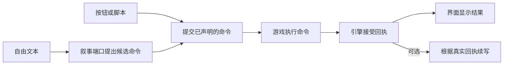

# 游戏开发者接入 Eidos

[English quickstart](developer-engine.en.md)

接入层把场景、游戏对象/组件、地图、状态和程序执行结果连接到 AI 叙事。游戏保留自己的渲染、输入、背包、战斗、物理与存档系统。Eidos 通过声明的命令提出交互，宿主程序回传真实结果，下一轮叙事读取这些结果。

独立 SDK 可在 Node.js 20+ 运行，无第三方运行时依赖。网络叙事使用平台提供的 `fetch`、`AbortController` 和 `AbortSignal.timeout/any`。从源码构建或运行仓库示例时，请按[仓库首页](../../README.md#开发者入口)的版本要求安装 Node.js。

## 跑通第一个游戏

从仓库根目录运行：

```bash
cd eidos
npm ci
npm run demo:engine
```

它先构建独立 SDK，再运行 [`locked-door.mjs`](../examples/engine/locked-door.mjs)。例子使用真实核心和宿主程序，叙事端口是确定性的离线脚本，不产生模型费用。流程包括错误钥匙、开门、解锁地图通路、场景移动、物理状态回传、保存恢复及重复回执。

世界文件是 [`courtyard.json`](../examples/engine/courtyard.json)。修改 JSON 中的场景、组件或状态即可改变交互资料；修改示例中的 execute 可接入自己的程序。

```bash
npm run build:sdk
npm run test:engine
```

`sdk/dist` 包含 CommonJS JavaScript 和 `.d.ts` 类型声明。SDK 根入口是 `@eidos/engine`，RPG 规则通过 `@eidos/engine/rpg` 导入，支持 `require` 和 ES module。下文示例使用安装后的包名，Eidos 应用源码内也可以从 `@/lib/engine` 导入通用核心。

```bash
npm run pack:sdk
```

切到自己的游戏项目，把路径替换为刚生成的本地安装包。

```bash
npm install /path/to/eidos/build/sdk/eidos-engine-0.5.2.tgz
```

构建器使用同一份生产源码，重写包内引用并保留公开类型所需声明。遇到未声明的运行时依赖、无法解析的公开类型或非法输出路径会失败，旧有效产物会保留。`sdk/tsconfig.json` 用于检查源码接口；实际产物通过 `npm run build:sdk` 生成。

需要执行命令、保存与恢复时，从 `createEngineHost` 开始。用 `persist()` 创建初始存档，用 `synchronize()` 提交战斗或时钟等独立程序的真实结果。只需底层协议时，可直接使用 `EngineSession`。 [SDK 宿主接入示例](../sdk/README.md#执行并恢复宿主命令)



自由文本也可以只产生正文。只有候选包含命令时，才进入执行和回执流程。

## 世界与交互对象

所有接口使用 JSON。有限数值、false、0、空字符串、数组和 null 原样保留；函数、Date、循环引用和原型保留键被拒绝。ID 非空、不含空白、最长 256 字符，名称与 ID 分开。生成的 request.id 是不透明引用，原样保存和回传，不自行拆分。

TypeScript 接口上声明的可选字段可以传 `undefined`，SDK 将其视作省略。游戏状态、命令参数、输出内部和数组项需要合法 JSON。无效 JSON 会报告字段路径，例如 `results[0].output.items[1]`。

| 字段 | 游戏提供的内容 |
| --- | --- |
| `id/name/description?` | 世界的稳定身份与公开介绍 |
| `currentSceneId/state` | 当前场景 ID 与全局状态 JSON 对象 |
| `scenes` | 以 ID 为键的 `{id,name,description?,visible?,state}` |
| `components` | 以 ID 为键的 `{id,kind,name,sceneId?,description?,visible?,enabled?,state}` |
| `map.nodes` | 以 ID 为键的 `{id,name,sceneId,position?:{x,y,z?},discovered?,state}` |
| `map.edges` | 以 ID 为键的 `{id,from,to,bidirectional?,blocked?,discovered?,state}` |
| `commands` | 以 ID 为键的 `{id,name,description?,target,parameters?,enabled?}` |

组件 kind 不预设枚举，可以是角色、道具、门、技能、UI 控件或自己的 ECS 组件。省略 sceneId 表示全局对象。坐标是宿主坐标，不由 Eidos 模拟物理或推断距离。

命令 target 为 `{kind:'world'}`，或 `{kind:'scene'|'component'|'mapNode'|'mapEdge',id}`。一个命令绑定一个具体目标，允许多个命令指向同一对象。parameters 是 JSON 参数说明，可放 JSON Schema，提供给叙事和宿主；宿主执行时负责实际参数、库存、碰撞及玩法权限校验。

`buildEngineContext(checkpoint)` 提供当前场景、当前/全局可用组件、已发现地图与可用命令。隐藏/禁用对象和封闭通路不会成为可调用目标。地图允许单向通路；反向移动需要 bidirectional 或另一条边。未来场景的完整状态不进入上下文。

宿主应提供允许用于叙事的公开投影。state、description、参数说明和程序 output 是模型可读资料，不要把秘密答案或密钥放进去。getSnapshot() 供可信游戏保存，包含完整宿主投影，不是玩家权限过滤接口。

## 会话与直接交互

```ts
import { createEngineSession } from '@eidos/engine';

const session = createEngineSession({ id: 'save-01', world });
const commit = await session.requestCommands({
  id: 'button-click-001', expectedRevision: 0,
  commands: [{ commandId: 'unlock', args: { key: 'brass' } }],
});
// commit.commands[0]: {id,operationId,commandId,target,args}
// 门、资源与地图仍保持原值，命令等待游戏程序执行。
```

每次有效操作增加一次 revision。操作 ID 由宿主创建并保留；原 ID + 原参数重试返回原回执，旧版本不会再次扣资源或推进。同 ID 改参数返回 operation_conflict。每个 session 有自己的串行队列，两个会话互不取消或共享游戏状态。

有 pending 命令时先回传全部结果，再进行新的交互。根据 getSnapshot().pending 可恢复中断流程。直接按钮交互不调用模型。

## 程序结果与状态变化

```ts
const request = commit.commands[0];
const result = await myGame.execute(request);
await session.report({
  id: 'program-result-001', expectedRevision: commit.revision,
  results: [{
    requestId: request.id,
    status: result.ok ? 'completed' : 'failed',
    message: result.message, output: result.output,
    ...(result.ok ? { changes: result.changes } : {}),
  }],
});
```

status 为 completed / failed / denied。失败或拒绝也形成事实回执，下一轮叙事能读到原因。失败项不能附带 changes；混合批次把成功项的变化放在各自的 results[i].changes 中。报告覆盖当前全部 pending，拒绝外来、重复或缺失 requestId。顶层 changes 是整批成功后的附加更新，只有所有项 completed 时可用。

EngineChanges 支持：

- state：替换整个全局状态对象，携带希望保留的其他键。
- currentSceneId：切换到已有场景，适合移动、传送的真实结果。
- scenes/components：实体数组，按 ID upsert；实体 state 是整个替换值。
- removeScenes/removeComponents：ID 数组，最终不能留下场景、组件、地图或命令的悬空引用。
- map：替换完整 nodes/edges，包括坐标、方向和通路状态。
- commands：替换完整命令表，适合技能、按钮和场景能力变化。

整批验证通过才接受，不留下部分扣款或地图更新。程序执行与状态确认是两个边界：外部副作用由游戏承担，**宿主需用 request.id 对执行去重，并把执行日志与游戏存档一起保存**。report 去重不能撤回已经运行的动画、写库或物理操作，不能替代执行器自身的幂等性。

独立于叙事的程序可同步结果：

```ts
await session.synchronize({
  id: 'battle-42', expectedRevision: session.getSnapshot().revision,
  source: 'combat', summary: '战斗结束，玩家剩余 70 点生命',
  output: { winner: 'player', damage: 30 },
  changes: { state: { ...session.getSnapshot().world.state, health: 70 } },
});
```

source 是游戏程序的标识。status 默认 completed；失败/拒绝时省略 changes，仍可报告 output 与原因。

## AI 叙事端口

EngineNarrator.generate({context,input},{signal?}) 返回 `{segments,commands?,usage?}`，可接脚本、自己的模型服务或记录回放：

```ts
import { createHttpNarrator, createEngineSession } from '@eidos/engine';
const narrator = createHttpNarrator({
  url: 'http://127.0.0.1:3000/api/engine/v1/narrate',
  token: process.env.EIDOS_ENGINE_TOKEN,
});
const session = createEngineSession({ id: 'save-01', world, narrator });
const controller = new AbortController();
const response = await session.act({
  id: 'input-001', expectedRevision: 0,
  text: '用铜钥匙打开门', target: { kind: 'component', id: 'door' },
}, { signal: controller.signal });
```

segments 是 narration 或 dialogue。对白使用当前组件的 speakerId，游戏自己绑定名称、立绘、配音和动画。commands 与按钮操作走相同校验。宿主执行命令并提交 `report` 后，可用 `narrateReceipts` 承接真实结果。模型不能通过响应写入 state、地图或回执。

自由文本若先由模型选命令，执行后又需要模型续写，共调用两次叙事端口。按钮可直接提交命令并展示程序的反馈，也可以在回执接受后按需调用 `narrateReceipts({ id, expectedRevision, instruction? })`。可用 `instruction` 指定语言或风格，续写仍只接受正文。界面重试时复用同一 ID、版本和指令。如果配置裁掉了全部回执，SDK 会返回 `missing_receipts`。

每次返回 EngineCommit，包含 operationId、revision、segments、commands、receipts、events、可选 usage。events 为 narrative.committed / command.requested / program.reported / world.updated，可刷新游戏组件。API 生成的候选尚未改变会话；核心校验并保存后才返回提交事件。

用量属于当前请求，核心不依赖全局审核队列或费用订阅。调用失败不隐式重复付费请求，取消的迟到结果不能推进会话。真实模型文本有随机性；回归应记录模型提案和程序回执，重放以验证状态结算。

长局可以在创建和恢复会话或宿主时设置 `context: { maxHistory: 24, maxReceipts: 12, maxBytes: 128_000 }`，也可传给 `buildEngineContext(checkpoint, options)`。数量限制保留最新条目，设为零可省略相应列表。字节限制先移除最早的历史，再移除较早的回执，保留最新一份回执。如果当前投影和最后一份回执已经超过预算，则在调用模型前返回 `context_budget_exceeded`。预算按 UTF-8 计算，仅覆盖 context JSON。HTTP 封套、当前输入和模型 token 窗口需要额外余量。

默认上下文包含全部历史和回执。裁剪只作用于发送给叙事端口的上下文，检查点仍保存完整日志，用于恢复和操作去重。

## 存档与持久化

```ts
const saved = JSON.stringify(session.getSnapshot());
const restored = restoreEngineSession(JSON.parse(saved), { narrator, persistence });
```

检查点包含协议版本、世界、历史、pending、真实回执及去重记录。低层恢复验证世界结构、操作日志和待执行命令的当前目标。当前世界值与独立游戏存档是否一致，需要与可信宿主投影核对。`restoreEngineHost` 自动完成这项核对，也会纳入已执行但未回报的变更。完整操作日志是恢复 v1 检查点的必要条件。

长局可用 `maxSettledExecutions` 减少宿主日志的重复记录，用 `getStorageStats()` 监测增长。引擎检查点仍随操作增长，需为长局预留存储容量。宿主存档 v2 允许裁剪已结算的重复日志，并为独立同步保存输入摘要。内部引擎检查点仍采用 v1。

SDK 0.5.0 起，持久化回调可用 `encodeEngineCheckpoint(checkpoint)` 或 `encodeEngineHostSnapshot(snapshot)` 选择紧凑 JSON。紧凑格式存储完整操作日志，恢复时重建 `turns`、`pending`、`receipts` 和每次提交的 `events`。宿主存档保留游戏状态、执行日志、同步摘要和原有 CAS 版本。恢复入口自动识别两种格式。编码函数用于 SDK 产生的快照，读档时照常验证日志和宿主投影。紧凑格式减少冗余字段，也相应减少了可相互核对的副本。需要检测整份存档的改动时，可在存储层做完整性校验。

可选 EnginePersistence.save(checkpoint,previousRevision) 在接受内存状态前调用。实现应原子校验 previousRevision 并写入，失败必须抛出且不写入；跨进程冲突由存储实现负责 CAS。新会话首次 previousRevision 为 0，各会话使用独立存储键。

写入失败返回 persistence_failed，内存停留在上个接受版本。保留原操作输入，以同 ID 重试只重试保存，避免再次调用模型。有待保存结果时其他操作返回 persistence_pending；重载后只能恢复已持久化检查点。

宿主存档版本与操作版本应分别比较。按钮操作读取 `host.getSnapshot().engine.revision`，存档事务读取磁盘上宿主对象的顶层 `revision`。

| 失败发生的位置 | 恢复方法 |
| --- | --- |
| 命令请求或叙事保存失败，会话仍在内存中 | 用原 ID、版本和输入重试该操作 |
| 命令已持久化，执行或回执尚未完成 | 读取存档并调用 `host.resumePending()`；已保存的执行结果会被复用 |
| 另一个进程已写入更新版本 | 重新读档，再根据当前状态决定是否重新发起行动 |

## HTTP 协议 v1

在 Eidos 服务端的 `eidos/.env.local` 中配置接入令牌及模型。应用界面里的个人模型设置不会配置这个端点。 [环境变量示例](../.env.example)

```dotenv
EIDOS_ENGINE_TOKEN=your-private-game-server-token
EIDOS_ENGINE_PROVIDER=custom-openai-compatible
EIDOS_ENGINE_ENDPOINT=http://127.0.0.1:11434/v1
EIDOS_ENGINE_MODEL=your-installed-model
EIDOS_ENGINE_API_KEY=your-provider-key-if-required
```

provider 使用现有 Eidos 厂商 ID；未覆盖时沿用默认 ALICE 配置及服务器角色/厂商环境密钥。配置不随检查点保存。

`POST /api/engine/v1/narrate`，Authorization: Bearer EIDOS_ENGINE_TOKEN，请求：

```ts
{ version: 1, context: buildEngineContext(checkpoint), input: { text, target? } }
```

成功响应：

```ts
{ version: 1, sessionId, revision, proposal: { segments, commands }, usage? }
```

这是无状态候选生成接口。Unity、Godot 或其他语言可发送同一 JSON，在游戏里执行命令、维护存档；TypeScript 宿主可直接使用 SDK 的提交和版本检查实现。接口不在服务器创建会话或运行客户端代码。浏览器跨域接入通过自己的游戏服务器代理，不开放 CORS；Bearer token 应由可信游戏服务持有。

本地启动脚本默认只监听回环地址。需要给其他游戏服务转发时，应只路由这个受 Bearer token 保护的端点。普通应用 API 包含语音进程和本地资源操作，仅供本机使用。 [本地使用边界](../../SECURITY.md#本地使用)

请求体上限 2 MiB，每进程最多 4 个并发，90 秒总限时。每个被接受的 HTTP 请求都可能调用模型。请求超时后由宿主决定是否重试，重试可能再次计费。错误是 `{error:{code,message},usage?}`，输出校验失败时仍返回已知真实用量。

| HTTP 状态 | 含义 |
| --- | --- |
| 400 | invalid_input：版本、JSON、引用或字段无效 |
| 401 | unauthorized：Bearer token 不匹配 |
| 403 | invalid_input：跨站浏览器请求 |
| 413 | invalid_input：请求体超过上限 |
| 422 | context_budget_exceeded：完整上下文超过模型窗口 |
| 429 | busy：并发占满 |
| 499 | aborted：调用者取消 |
| 502 | invalid_proposal 或厂商错误码：生成/输出失败 |
| 503 | engine_not_configured / model_not_configured：缺少配置 |
| 504 | timeout：总限时到达 |

客户端核对 sessionId/revision/version，拒绝其他会话的结果。EngineHttpError 提供 status、code、message、可选 usage。

## 复用现有 Eidos 世界

应用内适配器 src/lib/game/engine-world.ts：

```ts
const world = buildEidosEngineWorld({ world: eidosWorld, snapshot });
const playerInput = engineCommandToPlayerInput(commandRequest, { world: eidosWorld, snapshot });
// playerInput 交给现有正常行动管线，由程序确认真实接受结果。
```

适配公开场景、已知地图、现场人物、发现线索、背包、任务和可见玩法资源。命令翻译前再次核对对象、参数及通路。内部设定、未发现线索、世界秘密、隐藏资源和保存的未读正文不导出。

## 复用文字 RPG 的结算规则

`@eidos/engine/rpg` 提供同步的 `prepareRpgAction`，与正式 GameScreen 的 `src/lib/game/action-runtime` 使用同一份实现。它可在 Node 或独立游戏宿主中运行，无 React、DOM、IndexedDB、网络和模型调用。

```ts
import { createRpgSnapshot, prepareRpgAction, buildEidosEngineWorld } from '@eidos/engine/rpg';
const initial = createRpgSnapshot({ world, playerName: '旅人', sceneId: 'hall' });
// 新游戏可省略 sceneId 或指定 time。资源与作者状态使用插件声明的初值。
// 恢复时使用保存的快照，不重新初始化；初始化不执行人物推演、文件操作或模型请求。
```

```ts
const prepared = prepareRpgAction({
  world, snapshot, response: acceptedResponse,
  input: '用钥匙开门', actionId: request.id, timestamp: Date.now(),
  // 可选：segments、introspection、inputSource、history（日记所需）
});
// 所有规则通过后，宿主一次接受世界状态。
world = prepared.world;
snapshot = prepared.snapshot;
history.push(prepared.record);
for (const effect of prepared.effects) handleHostEffect(effect);
```

输入是已经完成的行动或程序结果。准备过程不会修改输入；无效规则、拒绝的行动和未完成的工具请求抛错，不产生部分状态。返回规范化 `response`、实际 `segments`/`text`、时间变化、最终场景的行动记录和宿主效果。地图更新无法确认时沿用现有游戏规则：保留地图，跳过该轮移动，并返回 `map.rejected`；其余已接受后果仍结算。生成的物品和百科 ID 由 actionId 决定，重复准备得到同一结果；对同一结果的重复提交仍须由宿主日志或 EngineSession 去重。

| 领域 | 结算数据与边界 |
| --- | --- |
| 场景与地图 | sceneChanges、mapUpdates、已访问地点、通路阻断、探索度与公开发现 |
| 组件与玩家 | 背包、文档引用、线索、百科、关系、主人公状态；统一 NPC 记忆保留 |
| 状态与玩法 | 时间、天气、时间线、因果预测、插件资源、作者规则、原卡变量和章节账本 |
| 程序结果 | 已确认结果只补写正文，不再次扣资源、移动或推进世界自动事件 |
| 宿主效果 | scene.entered、diary.requested、encyclopedia.updated、map.rejected |

场景人物初始化、日记生成、角色设定回执、文件读写、审核、世界线保存及现实工具执行仍由宿主管理。浏览器通过 `rpgActionStorePatch` 一次更新领域状态；文件/变量预检期间若分支改变，原有守卫继续丢弃过期回复。不要把未审核的模型文本直接当成外部程序的真实执行结果。

## 可玩的开发测试项目

`examples/rpg/locked-door.mjs` 直接消费 SDK，和旁边的 `world.json` 一起复制到已安装 SDK 的新项目，可不作修改运行 `node locked-door.mjs`。它完成失败开门、对话、道具和规则、地图移动、恢复未回传结果及去重；仓库内运行 `npm run demo:rpg`。

`dev/engine-game/` 是本仓库自带的两场景测试游戏，不加入生产页面或模组发布内容。它使用 `EngineHost`、共享 RPG 结算和离线叙事，无需密钥或付费请求。

```bash
npm run demo:engine-game  # Node 验证，包含紧凑存档和恢复已执行但未上报的命令
npm run dev:engine-game   # 在 http://127.0.0.1:3031 操作
```

先尝试开门，看到失败且资源不变，再与守门人交谈、捡起钥匙、开门并进入庭院。`game.ts` 只需提供投影、程序执行、叙事和持久化回调。`EngineHost` 负责提交回执及恢复未完成的命令。浏览器存档保留旧试玩存档的读取能力，后续以紧凑 JSON 写入。展开「接入状态」可以查看已写入的 UTF-8 字节数、宿主存档版本和程序回执。示例的模型上下文保留最多 24 条历史和 12 条回执，字节上限为 128,000。

演示存档把 RPG 快照、行动记录、引擎检查点和宿主执行日志作为一份数据保存。`EngineHost` 先保存执行结果及待上报请求，再提交回执。若进程在两次写入之间退出，恢复后 `resumePending()` 会复用已保存的结果。外部程序仍应将副作用和 `request.id` 的去重记录放在同一可靠事务内。
